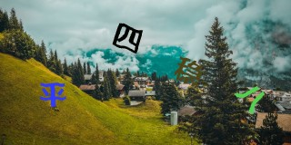

# 网易易盾 — 样本、方法与求解器状态

> 厂商：网易易盾 | 来源：https://dun.163.com/trial | 类型：10 | 样本：96
>
> 本页只记录求解器状态，不复制源求解器结果；`review.state` 初始为 `pending` 或 `not-applicable`，审查结果留空待回填。

## 一、类型总表

| 类型 | 中文 | 变体 | 样本 | 方法 | 求解器 / 源记录 | 审查 | 思路与说明 |
|---|---|---|---:|---|---|---|---|
| `jigsaw` | 乱序拼图 | classic / inference | 12 | CV | 有求解器（exists）· 中 | pending | Canny α-边缘模板匹配；无 LLM；打乱背景不稳定；结果待人工审查 |
| `slide-rotate` | 旋转拼图 | enhanced-rotate | 12 | CV | 有求解器（exists）· 高 | pending | 旋转几何 + 边缘方向一致性；无 LLM；源记录可过；结果待人工审查 |
| `icon-click` | 图标点选 | classic | 12 | VLM+CV | 有求解器（exists）· 未知 | pending | 主路径视觉 LLM 读图，CV 兜底；VLM 无需训练，起步便宜；源目录有求解输出，未统一验证 |
| `text-click` | 文字点选 | classic / enhanced | 12 | DET+OCR+VLM | 有求解器（exists）· 高 | pending | YOLO 检测 + Siamese 字形 + VLM 仲裁；VLM 只对分歧点调用；源方案 12/12；结果待人工审查 |
| `word-order` | 语序点选 | classic | 12 | OCR+VLM | 有求解器（exists）· 未知 | pending | 点击求解器已覆盖；建议 OCR + VLM 语序；源目录有 click 求解器；准确率未统一验证；待审 |
| `word-group` | 语序选词 | classic | 12 | VLM | 有求解器（exists）· 高 | pending | llm_solver 选词/排序；无需训练；源 llm_solver 12/12；待审 |
| `spatial` | 空间推理 | space-inference | 12 | VLM+CV | 有求解器（exists）· 高 | pending | 本地 CV 定位图形 + 视觉 LLM 选空间关系；源记录 3/3 离线；结果待审查 |
| `avoid` | 障碍躲避 | classic | 12 | VLM+ACT | 有求解器（exists）· 高 | pending | 视觉 LLM 识别目标/障碍 + 贝塞尔轨迹；源 llm_solver 12/12；待审 |
| `invisible` | 无感 | sense | 0 | NONE(ACT) | 无求解器（none）· 未知 | not-applicable | 无题面；需浏览器/环境行为 |
| `sms` | 短信上行 | classic | 0 | NONE | 无求解器（none）· 未知 | not-applicable | 无题面，需短信 |

> 方法标签：`CV`=传统视觉；`DET`=目标检测；`OCR`=文字识别；`VLM`=多模态 LLM；`ASR`=语音识别；`PROTO`=协议/枚举；`ACT`=行为/轨迹；`AUDIO`=音频信号；`NONE`=无求解器（括号内为建议路线）。VLM 无需训练数据、按调用计费，起步便宜；量大时 CV 更便宜，常见组合是 CV/OCR 先定位、VLM 只对分歧或语义点调用。

## 二、样本速览

每类取 1 组代表样本；完整样本见 `cases/yidun/`。

| 类型 | 方法 | 代表样本 | 样本数 |
|---|---|---|---:|
| `jigsaw` | CV |  | 12 |
| `slide-rotate` | CV |  | 12 |
| `icon-click` | VLM+CV |  | 12 |
| `text-click` | DET+OCR+VLM |  | 12 |
| `word-order` | OCR+VLM |  | 12 |
| `word-group` | VLM |  | 12 |
| `spatial` | VLM+CV |  | 12 |
| `avoid` | VLM+ACT |  | 12 |
| `invisible` | NONE(ACT) | — | 0 |
| `sms` | NONE | — | 0 |

## 三、求解器与人工审查

> 本库只记录求解器状态，不复制源求解器结果。 审查通过/不通过由维护者后续回填。

### 无求解器（none）

以下类型没有撰写求解器，仅为样本收录。原因包括未尝试、仅采集、优先级低、能力不足或未完成；具体以说明为准。

| 类型 | 样本 | 方法 | 准确率（源记录） | 说明 |
|---|---:|---|---|---|
| `invisible` | 0 | NONE(ACT) | 未知 | 无题面；需浏览器/环境行为 |
| `sms` | 0 | NONE | 未知 | 无题面，需短信 |

### 有求解器、待人工审查（exists）

以下类型有求解器与源记录准确率，但本库未复制结果（或仅复制了明确标注的结果），等待人工审查。

| 类型 | 样本 | 方法 | 准确率（源记录） | 说明 |
|---|---:|---|---|---|
| `jigsaw` | 12 | CV | 中 | Canny α-边缘模板匹配；无 LLM；打乱背景不稳定；结果待人工审查 |
| `slide-rotate` | 12 | CV | 高 | 旋转几何 + 边缘方向一致性；无 LLM；源记录可过；结果待人工审查 |
| `icon-click` | 12 | VLM+CV | 未知 | 主路径视觉 LLM 读图，CV 兜底；VLM 无需训练，起步便宜；源目录有求解输出，未统一验证 |
| `text-click` | 12 | DET+OCR+VLM | 高 | YOLO 检测 + Siamese 字形 + VLM 仲裁；VLM 只对分歧点调用；源方案 12/12；结果待人工审查 |
| `word-order` | 12 | OCR+VLM | 未知 | 点击求解器已覆盖；建议 OCR + VLM 语序；源目录有 click 求解器；准确率未统一验证；待审 |
| `word-group` | 12 | VLM | 高 | llm_solver 选词/排序；无需训练；源 llm_solver 12/12；待审 |
| `spatial` | 12 | VLM+CV | 高 | 本地 CV 定位图形 + 视觉 LLM 选空间关系；源记录 3/3 离线；结果待审查 |
| `avoid` | 12 | VLM+ACT | 高 | 视觉 LLM 识别目标/障碍 + 贝塞尔轨迹；源 llm_solver 12/12；待审 |

## 四、来源

来源：https://dun.163.com/trial。样本采集日期见各案例 `meta.json`；样本版权归厂商所有，仅用于研究与教学展示。
